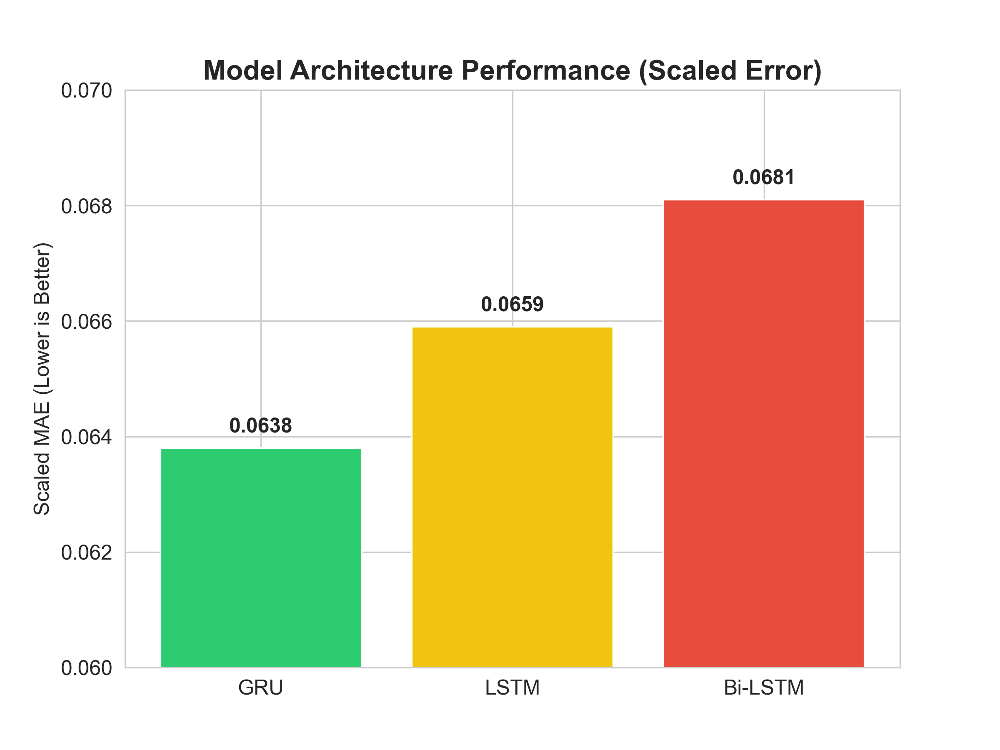
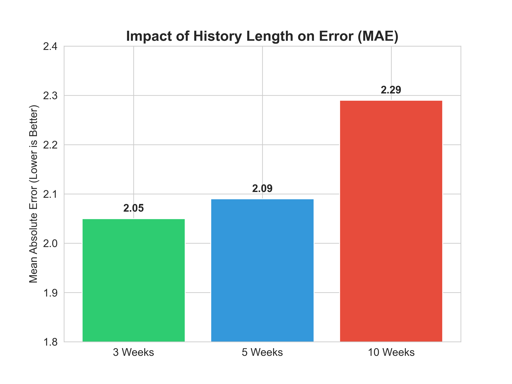
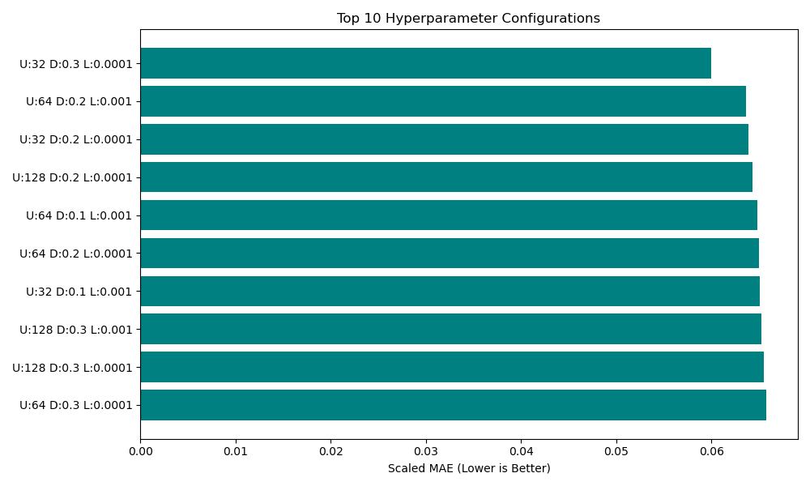
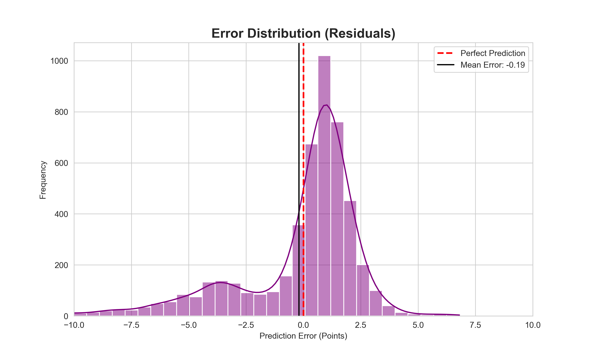
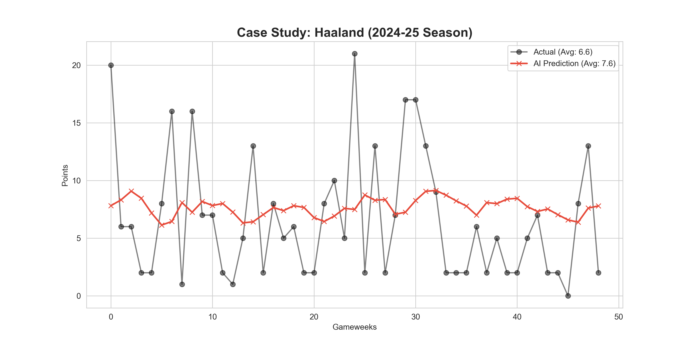

# Fantasy Premier League Points Prediction with Recurrent Neural Networks

Forecasting how many Fantasy Premier League (FPL) points each player will score in their next match, using the sequence of their recent performances. I benchmarked LSTM, Bidirectional LSTM and GRU models in TensorFlow/Keras, tested how much match history the model needs, and tuned the best architecture with a grid search.

**Result:** a tuned GRU with a 3-match lookback reached a scaled MAE of **0.0600** (about **1.86 points** per player-match) on an unseen season, down from 0.0681 (about 2.11 points) for the Bidirectional LSTM, a **12% reduction in error**.

## Approach

| Stage | What happens | Script |
| --- | --- | --- |
| Data | Pulls 2023–24 and 2024–25 gameweek data from the open [vaastav/Fantasy-Premier-League](https://github.com/vaastav/Fantasy-Premier-League) dataset, drops matches where the player didn't play | `data_ingestion.py` |
| Preprocessing | 14 features (minutes, goals, assists, clean sheets, bonus, ICT index, price, home/away and more), MinMax scaling, sliding windows of past matches per player | `pre_processing.py` |
| Split | Chronological: train on 2023–24 (9,758 sequences), test on the unseen 2024–25 season (4,930 sequences) | `pre_processing.py` |
| Architecture comparison | LSTM vs. Bidirectional LSTM vs. GRU | `train_model.py`, `train_model_bidirectional.py`, `train_gru.py` |
| Lookback experiment | 3 vs. 5 vs. 10 previous matches | `experiment_sequence_lengths.py` |
| Hyperparameter search | 18 GRU configurations (units × dropout × learning rate) | `hyperparameters.py` |
| Final model and predictions | Retrains the tuned GRU and ranks players by predicted points for the next gameweek | `final_prediction_tuned.py` |
| Evaluation and figures | Residual analysis, player case study, charts | `prediction.py`, `visualizations.py`, `more_visualizations.py` |

## Results

**Architecture** (3-match lookback, scaled MAE on the 2024–25 season; lower is better)

| Model | Scaled MAE | ≈ Points per prediction |
| --- | --- | --- |
| Bidirectional LSTM | 0.0681 | 2.11 |
| LSTM | 0.0659 | 2.04 |
| GRU | 0.0638 | 1.98 |
| **GRU, tuned** (32 units, dropout 0.3, learning rate 0.0001) | **0.0600** | **1.86** |

Points = scaled MAE × the 31-point range of the target (−5 to 26).



**Lookback length.** Shorter history did better: 3 matches (MAE 2.05 points) beat 5 (2.09) and 10 (2.29). Recent form matters more than long-run averages.



**Hyperparameter search.** The top 10 of 18 GRU configurations. Full results are in `hyperparameter_results.csv`.



**What didn't help.** Adding an opponent-difficulty feature (teams bucketed into 5 tiers by points conceded) made the error worse (0.0659 → 0.0683), so it was left out.

## Error analysis

Most errors fall within ±2.5 points. The long left tail shows the model under-predicts big hauls, which is expected for a regression model trained with MSE on a target where most outcomes are 1–2 points.



Player-level case study (Erling Haaland): the model tracks his baseline (average predicted 7.6 vs. actual 6.6) but can't anticipate one-off 15–20 point games.



## Run it

```bash
pip install -r requirements.txt

python data_ingestion.py            # optional: re-download data (fpl_data_23_25.csv is included)
python pre_processing.py            # build train/test sequences and the scaler
python train_gru.py                 # or train_model.py / train_model_bidirectional.py
python experiment_sequence_lengths.py
python hyperparameters.py
python final_prediction_tuned.py    # tuned model and next-gameweek rankings
```

Scripts read and write files in the working directory, so run them from the repo root. Charts are saved there too; the copies shown above are in `figures/`.

## Limitations and next steps

- The 2024–25 season served both for early stopping and for choosing hyperparameters. A separate validation split (for example, the last weeks of 2023–24) would give a cleaner estimate of performance on unseen data.
- The scaler is fit on both seasons in some scripts. Fitting it on training data only would remove a small leak.
- Ideas for future work: injury and rotation news through NLP, fixture congestion, and predicting the probability of a haul rather than only the expected points.

## Tech

Python, TensorFlow/Keras, pandas, NumPy, scikit-learn, Matplotlib, seaborn
